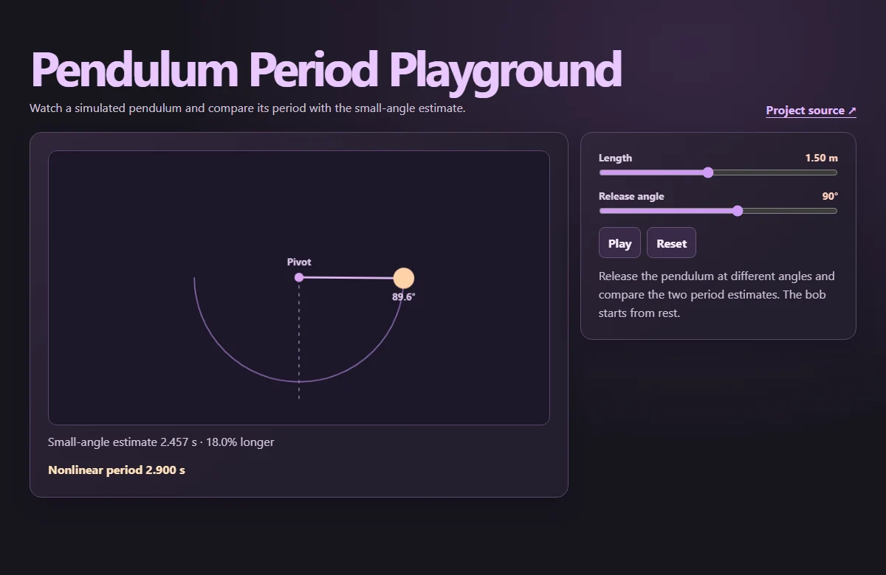

# Pendulum Period Playground

Watch a simulated pendulum and compare its period with the small-angle estimate.

[Open the browser app](https://surfingcoder.com/apps/pendulum-period-playground/)

## Run locally

Run the following command in this repository and open [localhost:8000](http://localhost:8000).

    python -m http.server 8000

This is the ideal point-mass pendulum in constant gravity with a massless rigid rod and no friction. The full period uses the complete elliptic integral through the arithmetic–geometric mean. The animation integrates the nonlinear equation with fourth-order Runge–Kutta.

## Verify

Run the following command with Node.js 22 or newer.

    node --test
